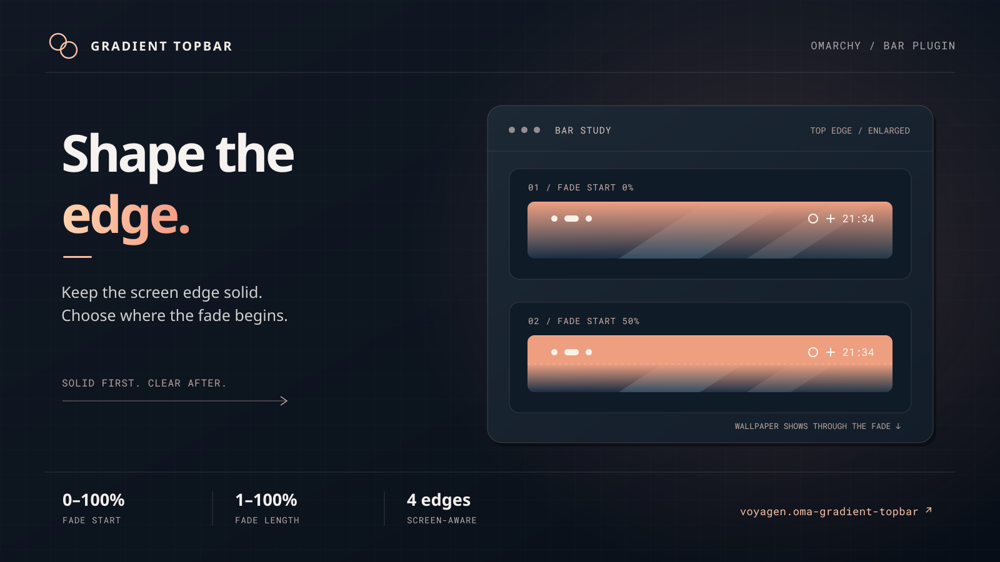

# Omarchy Gradient Topbar

A full-bar plugin for Omarchy Quattro. The background fades across the bar's thickness, from black at the physical screen edge to transparent toward the desktop. The transparent end reveals the actual wallpaper beneath the bar.



The illustrated marketplace preview enlarges the top bar to show how Fade start changes the solid section. Edit `preview.svg` and regenerate `preview.png` with `rsvg-convert -w 1600 -h 900 -o preview.png preview.svg`. The actual wallpaper and color depend on your settings.

## Requirements

- Omarchy Quattro's `omarchy-shell` bar (developed against Omarchy 4.0.4-1); this is not a GNOME extension or a Waybar theme.
- No extra packages, privileges, separate Quickshell process, or changes to packaged files. Plugins execute unsandboxed in the user's shell process.

## Install

Install from GitHub when this repository is published:

```sh
omarchy plugin add https://github.com/voyagen/oma-gradient-topbar.git --enable
omarchy bar use voyagen.oma-gradient-topbar
```

For a local checkout, copy the repository files into `~/.config/omarchy/plugins/voyagen.oma-gradient-topbar/` (not a symlink), then run:

```sh
omarchy plugin validate ~/.config/omarchy/plugins/voyagen.oma-gradient-topbar
omarchy-shell shell rescanPlugins
omarchy bar use voyagen.oma-gradient-topbar
omarchy restart shell
```

Selecting this bar replaces `omarchy.bar` without discarding your widget layout. On first load, it adds one `voyagen.oma-gradient-topbar.settings` widget to the end of the right section. If the bar does not appear, check `omarchy plugin list --json`, restart with `omarchy restart shell`, then inspect `qs log -p "$OMARCHY_PATH/shell" --tail 100` for QML errors. Rescanning alone can leave an older QML component loaded.

To update a Git-installed copy:

```sh
omarchy plugin update voyagen.oma-gradient-topbar
omarchy restart shell
```

## Usage

Click the Blend icon to open **Gradient settings**:

- **Transparency:** edge opacity, from 0% (opaque) to 100% (transparent).
- **Color:** a full `#RRGGBB` value; commit with **Apply** or Enter.
- **Fade start:** the solid part measured from the physical screen edge, 0–100% of bar thickness.
- **Fade length:** the distance faded after the solid part, 1–100% of bar thickness.

At Fade start 50% and Fade length 100%, the first half stays filled and the second half fades into the desktop. A shorter fade ends at `min(100%, Fade start + Fade length)`; any area after that is clear. Sliders preview while dragging and persist on release. Settings are shared across monitors in `~/.config/omarchy/shell.json` under `bar.gradient`. Without saved settings, the bar uses a black-to-clear fade over its full thickness. Only the background changes; widgets remain visible even at 100% transparency.

The fade follows the bar's position:

| Bar position | Screen edge | Desktop-facing edge |
| --- | --- | --- |
| Top | Top | Bottom |
| Bottom | Bottom | Top |
| Left | Left | Right |
| Right | Right | Left |

Move the bar with `omarchy bar position top|bottom|left|right`. Drag the Blend icon between sections like other widgets, or run `omarchy bar move voyagen.oma-gradient-topbar.settings --section left`. Widgets dropped in empty space go to the nearest widget edge in the left, center, or right section rather than an arbitrary pixel; the tray follows its saved position.

There is no separate full-bar background behind the solid segment and fade. `bar.transparent` does not remove the gradient. Text over the transparent portion depends on the wallpaper or window beneath it; a high-contrast theme helps.

## Validate

For a local checkout:

```sh
omarchy plugin validate .
```

This checks the package, not whether the running bar renders it. Restart with `omarchy restart shell` after editing QML. The optional `/usr/lib/qt6/bin/qmllint -I "$OMARCHY_PATH/shell" Bar.qml` may report unresolved Omarchy or Quickshell imports and warnings from the bundled upstream bar.

## Remove

Switch back to the built-in bar before removing this full-bar plugin:

```sh
omarchy bar use omarchy.bar
omarchy plugin remove voyagen.oma-gradient-topbar
```

If installed manually, remove only `~/.config/omarchy/plugins/voyagen.oma-gradient-topbar/` after switching back. Your widget layout and saved `bar.gradient` settings remain in `shell.json`; remove those settings separately if you no longer want them.

## Compatibility

`Bar.qml` and `BarModel.js` are based on Omarchy Quattro's built-in `omarchy.bar` (Omarchy 4.0.4-1). This full-bar replacement copies upstream bar internals and needs review when Omarchy changes its bar API. Per [Omarchy's shell reference](https://github.com/omacom/omarchy/blob/quattro/docs/omarchy-shell.md), service-backed third-party widgets may not retain every integration when hosted by a third-party full bar; check those widgets before making this your default.

## License

MIT for the plugin and Omarchy-derived bar; ISC for the Lucide Blend icon geometry. See [LICENSE](LICENSE).
